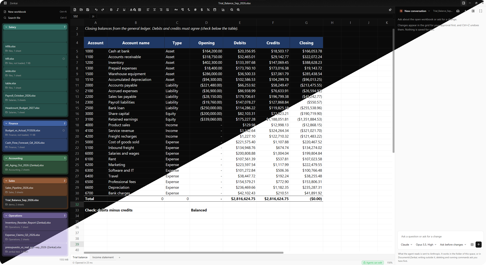

<h1 align="center">Zenkai</h1>

A fast, native spreadsheet for files too large or too messy for the usual tools.

  

Zenkai opens your `.xlsx`, `.csv` and `.tsv` files, recalculates Excel formulas and saves
them back without breaking what it cannot edit. It is free, open source and runs on your
machine: no account, no cloud.

## Install

Download the latest build from [Releases](https://github.com/EmilioGiordano/Zenkai/releases).
Windows is the main platform; Linux and macOS (Apple silicon) builds are experimental.

The Windows build is not signed yet, so SmartScreen asks first: click "More info", then
"Run anyway".

## Status

Zenkai is young. It keeps charts, images and other content it cannot edit when it saves, and
asks before a save would drop anything. Known gaps and plans are in the
[roadmap](docs/ROADMAP.md).

## Contributing

Bug reports with a file that breaks Zenkai are the most useful thing you can send. To build
from source or open a pull request, see [CONTRIBUTING.md](CONTRIBUTING.md). Zenkai is built
with the help of AI coding agents, under the rules in [AGENTS.md](AGENTS.md).

Formulas are calculated by [IronCalc](https://github.com/ironcalc/IronCalc) and the interface
is built with [GPUI](https://www.gpui.rs).

## License

[Apache-2.0](LICENSE)
